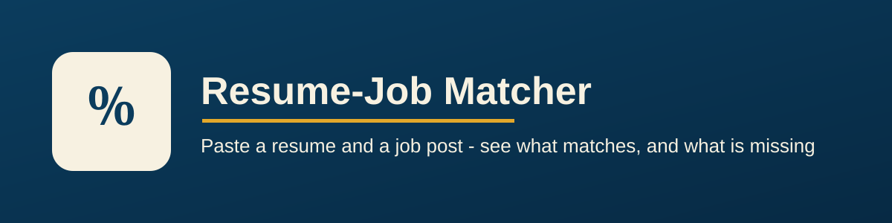

# Resume-Job Matcher

  [](LICENSE) 

**Paste a resume and a job description — this tool scores the match and lists exactly which job keywords your resume is missing.**

Recruiters and applicant-tracking systems screen resumes by keywords before a human ever reads them. This tool shows you that screening honestly, so you can fix real gaps instead of guessing.

## Try it in 30 seconds

```bash
pip install -r requirements.txt
python matcher.py sample_resume.txt sample_job.txt
```

Real output, from the sample files in this repo:

```
Keyword coverage: 46.7%  (7 of 15 job keywords found)
Overall text similarity: 14.8%

Keywords you have (7):
  learning, machine, classification, python, evaluate, evaluation, git

Keywords missing (8):
  data, accuracy, apis, datasets, deep, description, docker, embeddings
```

The sample resume is a real student ML resume; the sample job post asks for Docker, SQL-style data work and deep-learning basics — so the tool correctly flags a genuine gap.

## Web version

```bash
python app.py
```

Then open http://localhost:8000 — paste both texts into the page and get the same report in your browser. The web UI uses only Python's built-in server: no extra packages, nothing to configure.

## How it works

1. **TF-IDF** turns both documents into weighted word vectors (rare, specific words count more than common ones).
2. **Keyword extraction** ranks the job description's most important terms.
3. **Coverage** = how many of those key terms appear in the resume — the number that matters for screening.
4. **Cosine similarity** gives an overall text-similarity score as a second signal.

## Honest limitations

- It matches words, not meaning: "dataset" in your resume does not count for "datasets" in the job post yet (stemming is on the roadmap).
- A high score does not guarantee an interview — it only means the keyword screening is passed.
- Never add a keyword for a skill you do not have. The point is to find real gaps and go learn them.

## Tests

```bash
python -m pytest tests/
```

4 tests: identical texts score 100% similarity, known keywords are found, missing keywords (Docker, SQL) are reported, and an empty resume finds nothing.

## Roadmap

- Word stemming so singular/plural forms match
- PDF resume upload in the web UI
- A skill-gap study list: turn missing keywords into a learning plan

## Contributing

See [CONTRIBUTING.md](CONTRIBUTING.md).

## Licence

MIT — see [LICENSE](LICENSE) for the full text.
