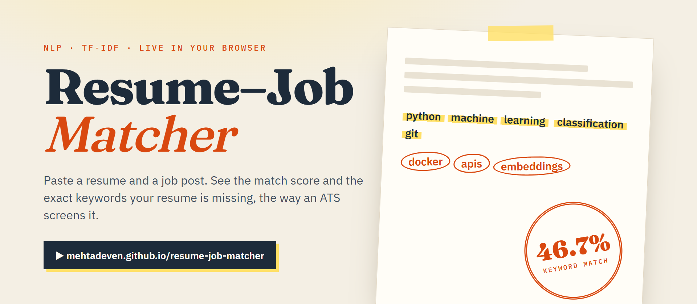
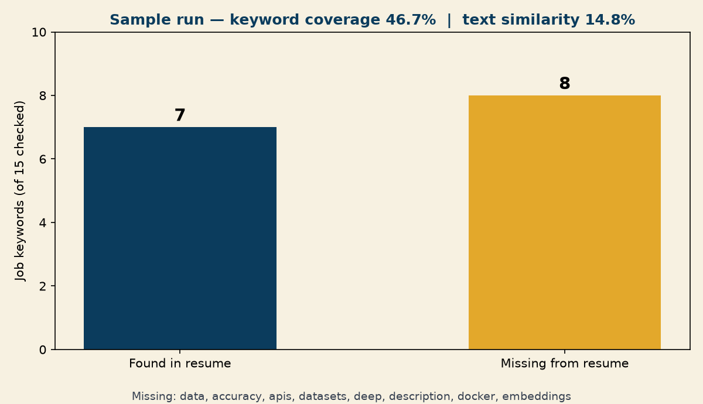
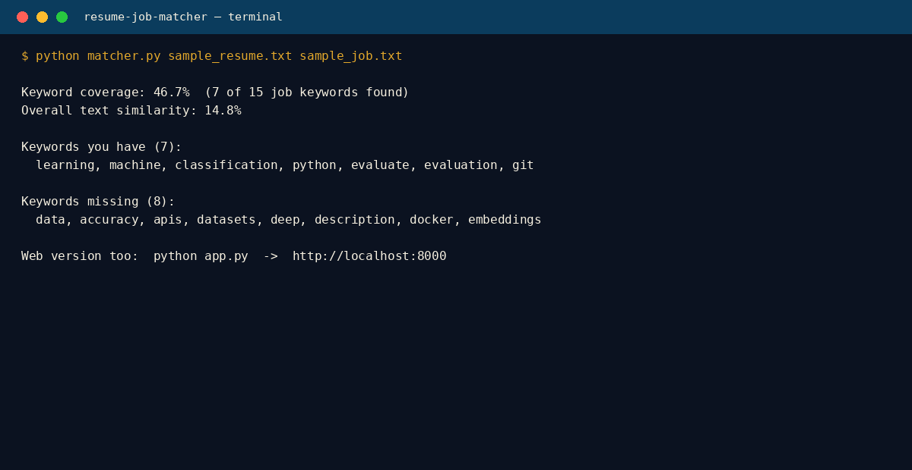
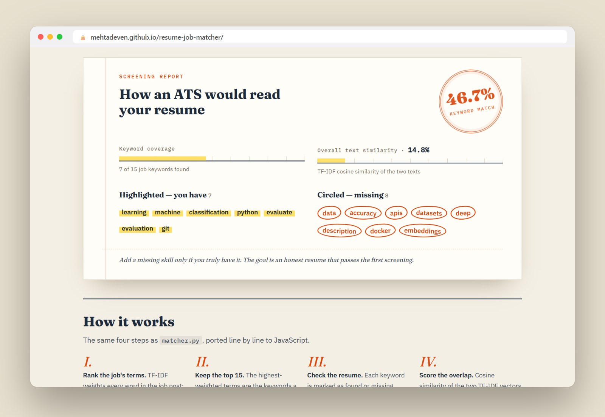

[](https://mehtadeven.github.io/resume-job-matcher/)

# Resume-Job Matcher

[](https://mehtadeven.github.io/resume-job-matcher/)   [](LICENSE) 

<p align="center">
  <a href="https://mehtadeven.github.io/resume-job-matcher/"><b>▶ Try the live demo</b></a> &nbsp;·&nbsp;
  <a href="#how-it-works">How it works</a> &nbsp;·&nbsp;
  <a href="https://mehtadeven.github.io/">Portfolio</a>
</p>

**Paste a resume and a job description — this tool scores the match and lists exactly which job keywords your resume is missing.**

Recruiters and applicant-tracking systems screen resumes by keywords before a human ever reads them. This tool shows you that screening honestly, so you can fix real gaps instead of guessing.

## Who this helps

- **Job seekers and internship applicants** — paste your resume and a job post, and see a match score plus the exact keywords the job asks for that your resume is missing.
- **Students preparing applications** — the included sample resume and job description show what a real gap list looks like before you use your own documents.
- **Anyone confused by ATS screening** — the tool mirrors how applicant-tracking systems compare keywords, so the screening stops being a black box.
- **Career mentors and teachers** — a concrete, runnable way to show a class why tailoring a resume to each job post matters.

## Download & run (2 minutes)

**Step 1 — Download the code**

```bash
git clone https://github.com/mehtadeven/resume-job-matcher.git
cd resume-job-matcher
```

No Git? On the GitHub page for this repo, click the green **Code** button, choose **Download ZIP**, unzip it, and open that folder in a terminal.

**Step 2 — Install what it needs** (Python 3.10 or newer)

```bash
pip install -r requirements.txt
```

**Step 3 — Run it**

```bash
python matcher.py sample_resume.txt sample_job.txt   # score the sample files
python matcher.py your_resume.txt your_job.txt       # score your own resume and job post
python app.py   # web version — then open http://localhost:8000 in your browser
```

**Step 4 — What you should see**

You should see `Keyword coverage: 46.7% (7 of 15 job keywords found)` for the samples — exactly like the demo image in the Demo section below.

## Results

Real output, from the sample files in this repo:

```
Keyword coverage: 46.7%  (7 of 15 job keywords found)
Overall text similarity: 14.8%

Keywords you have (7):
  learning, machine, classification, python, evaluate, evaluation, git

Keywords missing (8):
  data, accuracy, apis, datasets, deep, description, docker, embeddings
```

The sample resume is a real student ML resume; the sample job post asks for Docker, SQL-style data work and deep-learning basics — so the tool correctly flags a genuine gap.



*Generated by `generate_charts.py`, which runs the real matcher on the sample files above: 46.7% keyword coverage (7 of 15 found, 8 missing) and 14.8% overall text similarity. You can save the same chart for your own files with `python matcher.py your_resume.txt your_job.txt --chart chart.png`.*

## Demo



*Real run of `python matcher.py sample_resume.txt sample_job.txt` — 46.7% keyword coverage on the sample files in this repo.*

## Web version

```bash
python app.py
```

Then open http://localhost:8000 — paste both texts into the page and get the same report in your browser. The web UI uses only Python's built-in server: no extra packages, nothing to configure.

## Live demo

[](https://mehtadeven.github.io/resume-job-matcher/)

**Design:** a *recruiter's desk* theme — warm paper sheets with tape, Fraunces serif headlines, IBM Plex Sans/Mono, yellow highlighter on the keywords you have and red-pencil circles on the ones you're missing, plus a rubber-stamp score.

**[mehtadeven.github.io/resume-job-matcher](https://mehtadeven.github.io/resume-job-matcher/)** — the same matcher, ported line by line to JavaScript in [`web/`](web/), so it runs in your browser and your resume never leaves the page. The sample files give the same **46.7% (7 of 15)** as the Python version.

The browser version reads its stop-word lists and the sample texts from `web/matcher-data.js`, which `gen_web_data.py` generates from `matcher.py` — rerun it after changing `STOP_WORDS`. Every push to `main` redeploys the demo through [`.github/workflows/pages.yml`](.github/workflows/pages.yml).

## How it works

1. **TF-IDF** turns both documents into weighted word vectors (rare, specific words count more than common ones).
2. **Keyword extraction** ranks the job description's most important terms.
3. **Coverage** = how many of those key terms appear in the resume — the number that matters for screening.
4. **Cosine similarity** gives an overall text-similarity score as a second signal.

## Honest limitations

- It matches words, not meaning: "dataset" in your resume does not count for "datasets" in the job post yet (stemming is on the roadmap).
- A high score does not guarantee an interview — it only means the keyword screening is passed.
- Never add a keyword for a skill you do not have. The point is to find real gaps and go learn them.

## Tests

```bash
python -m pytest tests/
```

5 tests: identical texts score 100% similarity, known keywords are found, missing keywords (Docker, SQL) are reported, an empty resume finds nothing, and the `--chart` flag saves a real PNG chart.

## Roadmap

- Word stemming so singular/plural forms match
- PDF resume upload in the web UI
- A skill-gap study list: turn missing keywords into a learning plan

## Need help?

- **`pip` not found?** Use `python -m pip install -r requirements.txt` instead — it does the same thing.
- **Wrong folder error (file not found)?** Check your terminal is inside the repo folder — the prompt should end with the repo name, and `ls` (Mac/Linux) or `dir` (Windows) should list `README.md`.
- **Still stuck?** Open an Issue on this repo on GitHub with the command you ran and the full error message — that is the fastest way to get help.

## Contributing

See [CONTRIBUTING.md](CONTRIBUTING.md).

## Licence

MIT — see [LICENSE](LICENSE) for the full text.
